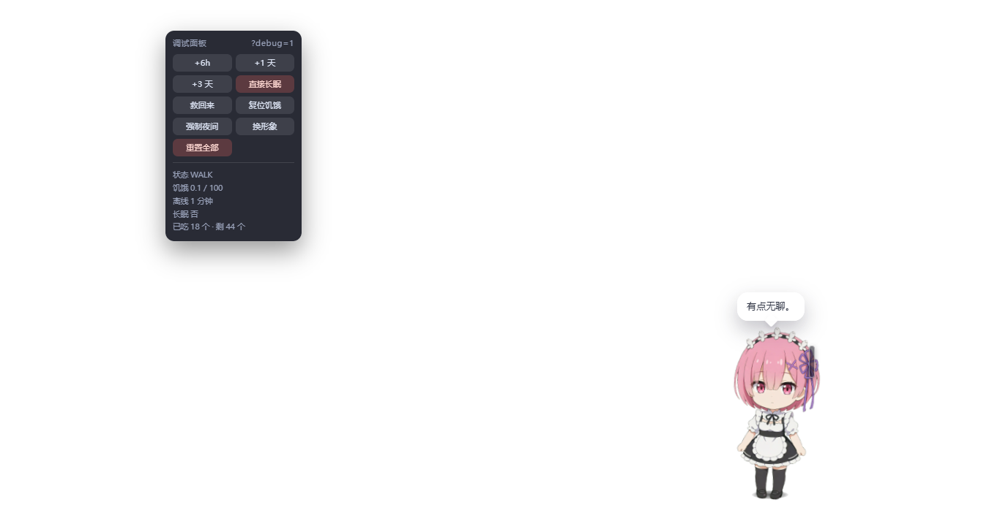

# 雷姆桌宠 · 桌面版

一只住在你 **Windows 桌面**上的小家伙（拉姆 / 雷姆）。

透明窗口浮在真实桌面上：她走来走去、发呆、眨眼，饿了会爬到你桌面上的图标旁边
把它们**真的移走**（移进桌面上一个叫「吃掉的食物」的文件夹），闲了跟你说句话。

> ⚠️ **桌面版会真的移动你的桌面文件。**
> 这是它和网页版唯一的区别，也是这个应用最"吓人"的一点。
> 第一次用建议先随便建两个没用的快捷方式试试 —— 右键她 →「吃掉的食物」→「全部吐回」能原样还回来。



## 怎么跑

```bash
npm install
npm start
```

启动后终端第一行是自检信息：

```
[pet] electron 45.1.0 | packaged false | userData …\desktop-pet-dev | debug true
```

她浮在真实桌面上，**左下角自带调试面板**（改参数不用重新打包）。
改完参数 → 托盘 →「重新加载」，立刻生效。

### 直接用打包好的版本

`release/` 里有现成的安装包，双击装上就能用：

```
release/雷姆桌宠-0.4.0-安装包.exe
```

安装过程可以自选目录，会建桌面快捷方式和开始菜单项，卸载走「设置 → 应用」。

## 她会做什么

| 动作 | 效果 |
|---|---|
| 什么都不做 | 自己走路、发呆、眨眼、抖呆毛 |
| 单击她 | 冒出一句话 |
| 快速连点 4 下（300ms 内） | 她会抖屏幕闹脾气 |
| 按住拖拽 | 拖起来跟着你的手倾倒，松手掉回地面弹一下 |
| **把桌面的文件拖到她身上** | 主动投喂，她张嘴吃掉（真文件被移走） |
| 右键她 | 菜单：说话 / 喂她 / 吃掉的食物 / 换个形象 / 吃货日志 / 她还记得什么 / 重置 |
| 放着不管 | 饱腹度慢慢下降，超过 72 她会自己爬过去找图标吃 |
| 等深夜 23:30 以后 | 她会提醒你睡觉 |
| 关掉程序隔几天再开 | 她饿着等你；饿满 100 且离线超过 96 小时，她会长眠，桌面多一个 `遗书.txt` |

她右上角有一根竖着的小条，是**饥饿值**（绿色→黄色→红色，越高越饿）——
桌面版没有假任务栏，就靠它告诉你她饿不饿。

## 托盘菜单

右键托盘里她的小头像：

| 菜单项 | 干什么 |
|---|---|
| 显示 / 隐藏 | 让她消失一会儿 / 再叫出来 |
| 打开吃掉的食物 | 直接打开那个文件夹（她吃掉的都在这儿） |
| 开机自动出现 | 写进你的启动文件夹，开机就有她（不需要管理员权限） |
| 打开数据文件夹 | 存档和日志在这儿 |
| 打开吃货日志 | 用记事本打开全文 |
| 重新加载 | 改完代码立刻生效 |
| 开发者工具 | 调试用 |
| 调试面板 显示/隐藏 | 折叠起那排调试按钮 |
| 退出 | **唯一的退出入口**（别在任务管理器里强杀） |

## 她把我的文件吃了，怎么要回来

右键她 → **吃掉的食物** → 「吐回来」。

- 文件会放回它**原来在的地方**，名字也还原
- 那个位置已经有同名文件了，会自动改名叫 `xxx (2)`，**不会覆盖掉你原来的**
- 万一原位置写不进去（比如「所有用户桌面」那种系统目录，普通用户没权限写），
  文件会放到**你自己的桌面**上，并在提示里告诉你

## 吃货日志

她吃掉什么、什么时候吃的、那是哪个应用，全都记着：

```
2026-10-31 11:53:06 | 吃掉 | 微信.lnk | 应用：Weixin | 来自 C:\Users\X280\Desktop
2026-10-31 13:52:27 | 吐回 | 微信.lnk | 放回 C:\Users\X280\Desktop
2026-10-31 13:52:30 | 还不了 | 照片.jpg | EPERM | 原位置写不进去
```

「应用」那一栏读的是快捷方式真正指向的程序（`.lnk` 用 Electron 的
`shell.readShortcutLink` 解析），比如 `微信.lnk` → `Weixin`。

三个地方能看到：

- 右键她 → **吃货日志**（应用里看，最近 60 条）
- 右键她 → **她还记得什么**（同一份日志的最近 12 条）
- 托盘 → **打开吃货日志**（记事本打开全文，在 `%APPDATA%\desktop-pet\吃货日志.txt`）

## 目录结构

```
index.html            入口
electron/
  main.js             主进程：窗口、托盘、鼠标穿透、文件搬运
  preload.js          往渲染层暴露必要的接口（contextBridge）
src/js/
  config.js           所有可调参数（饥饿、速度、台词）
  util.js             工具函数
  bridge.js           数据出入口的接线
  adapter-electron.js 桌面版适配器：读写文件、扫桌面图标
  chars.js            拉姆 / 雷姆 的立绘定义
  pet-face.js         表情层（五官位置、眨眼、笑眼）
  pet.js              角色本身：走路、拖拽、吃饭、发呆
  hunger.js           饥饿度、进食、存档
  icons.js            图标清单：位置、谁被吃了
  fsm.js              状态机（idle / walk / eat / sleep…）
  bubble.js           对话气泡
  scene.js            场景编排
  night.js            深夜提醒
  debug.js            调试面板（?debug=1）
  main.js             串起一切：菜单、弹窗、启动流程
src/css/
  base.css            基础布局、透明窗口
  pet.css             角色动画
  ui.css              菜单、弹窗、气泡、toast
assets/
  ram.png / rem.png   两张立绘
  icon.png            托盘图标
  icon.ico            打包用的 exe 图标
tools/
  start.js            启动器（处理 ELECTRON_RUN_AS_NODE 等坑）
  build.js            打包脚本（解包 + NSIS 安装包）
  selftest.js         端到端自检
  ...                 美术工具
docs/                 使用说明、台词池
```

## 开发

```bash
npm install
npm start             # 启动（默认带调试面板）
npm run start:debug   # 强制开调试面板
npm run selftest      # 端到端自检：真的吃一个文件、吐回来、点弹窗…
npm run shot          # 启动 5 秒截一张桌面图就退出
npm run build         # 打包成 NSIS 安装包
npm run build:dir     # 只出免安装的绿色版文件夹
```

自检跑在**假桌面**上（临时目录），全程不碰你真实的桌面和回收站。

### 打包

```bash
npm run build
```

产物：

- `dist/nsis/雷姆桌宠-<版本>-安装包.exe` —— NSIS 安装包（约 120 MB）
- `dist/雷姆桌宠-win32-x64/` —— 免安装的绿色版文件夹

打包脚本走国内镜像（`ELECTRON_MIRROR` / `ELECTRON_BUILDER_BINARIES_MIRROR`），
GitHub 在国内不通也能构建。

## 已知坑

| 现象 | 原因 |
|---|---|
| 点了没反应，什么都没弹出来 | 打包版 exe 正在跑时会抢单实例锁。开发版已用独立 userData（`desktop-pet-dev`），两个能同时跑 |
| 点不到桌面图标 | 只有她身上那一片接管鼠标，其余穿透。若整块桌面都点不到，是穿透失效了，托盘里隐藏再显示一次 |
| 透明窗口黑底 / 闪屏 | 少数显卡驱动的问题。`DESKTOP_PET_NO_GPU=1` 启动可关硬件加速 |
| 调试面板浮在真实桌面上 | 开发版默认开着，方便调参；不需要时托盘里折叠掉 |
| 杀毒软件报警 | 未签名的 Electron 程序常被误报。见 [`docs/发布说明.md`](docs/发布说明.md) |

## 存档在哪

| 版本 | 存档路径 |
|---|---|
| 开发版（`npm start`） | `%APPDATA%\desktop-pet-dev\pet-state.json` |
| 打包版 | `%APPDATA%\desktop-pet\pet-state.json` |

两者隔离，可以同时跑。托盘 →「打开数据文件夹」能直接找到。

## 网页版在哪？

同一个项目还有一个**网页版** —— 双击 `index.html` 就能玩，一格真实文件都不碰。

👉 [雷姆桌宠 · 网页版](../网页版本/)

## 许可

MIT
